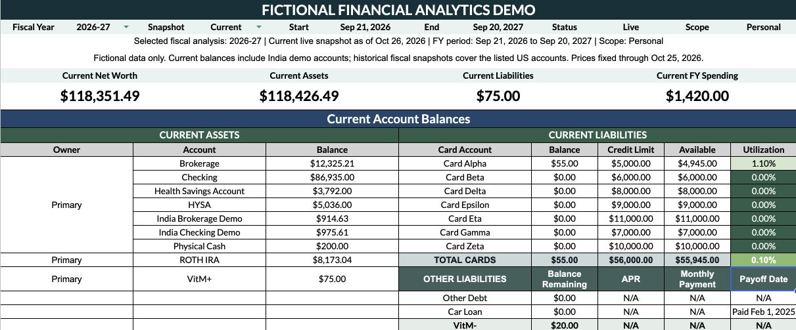
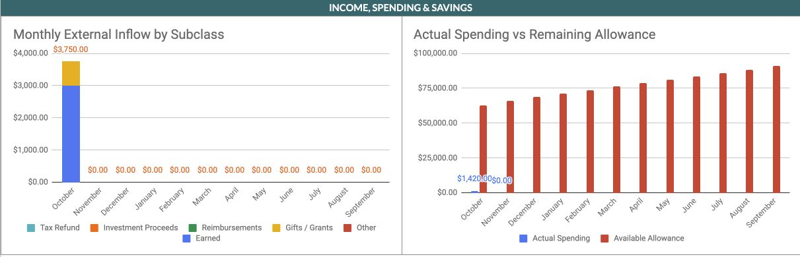
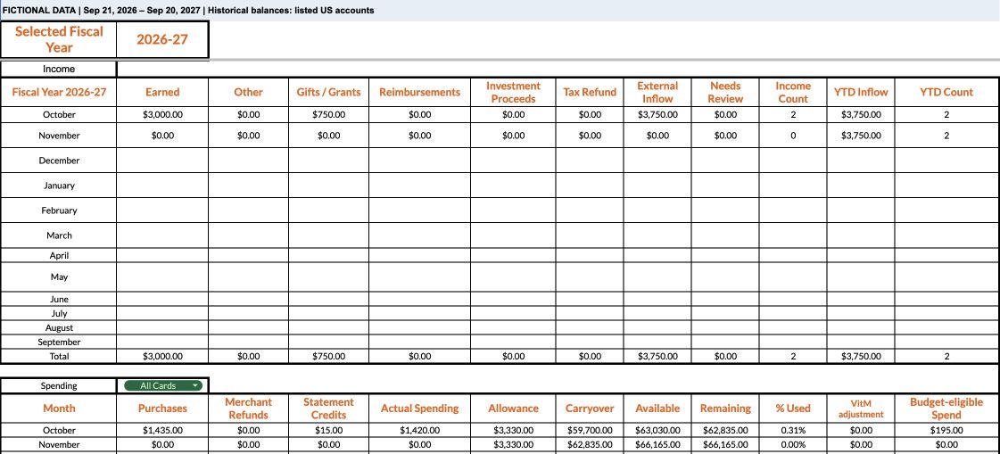
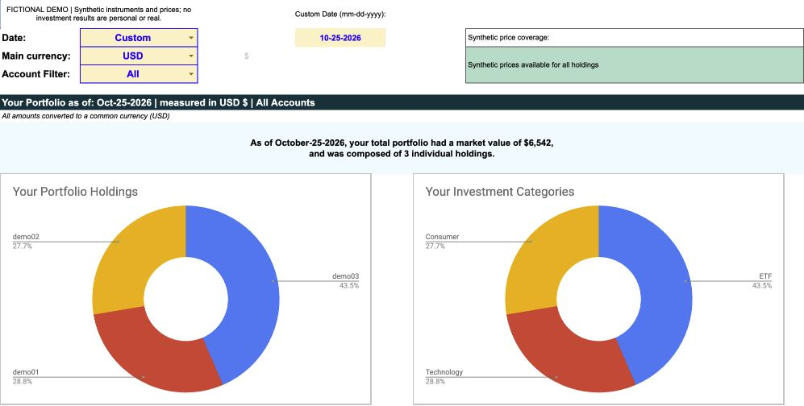
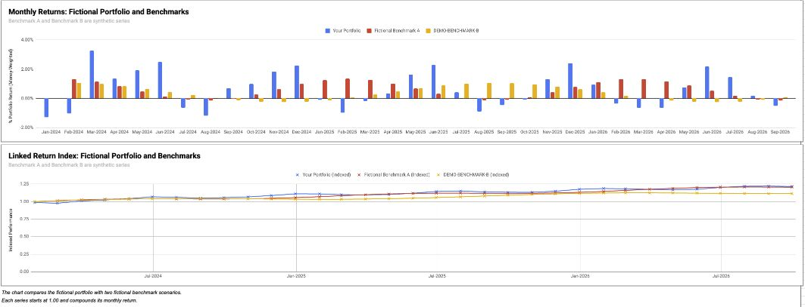

# Portfolio walkthrough

**GitHub documentation — five frames for a concise demonstration.**

The financial scenario is fictional and fixed as of October 25, 2026. Completed-month investment performance ends September 30, 2026. Keep that distinction in captions and narration. This sequence should take roughly two to three minutes.

## 1. Connected dashboard

**Caption:** “A connected view of a fictional financial scenario: assets, liabilities, liquidity and fiscal spending.”

Start with the synthetic-data notice and selected fiscal year. Explain that the dashboard pulls from transaction records and account definitions. Current consolidated balances include fictional India accounts; historical fiscal snapshots cover the listed US accounts.

**Narration:** “I built this tracker to connect day-to-day records with an understandable view of balances and spending. Every financial value shown here belongs to a fictional demonstration scenario.”

## 2. Spending patterns

**Caption:** “Fictional records show monthly external inflow and spending versus available allowance.”

Explain why transaction type matters: an expense, transfer, refund and card payment should not all count as ordinary spending. The chart is the presentation layer; the ledgers and registries provide the definitions underneath it.

**Narration:** “Separate transaction types preserve what each entry means. Shared accounts and categories then let the same records support multiple summaries without re-entering the data.”

## 3. Fiscal-year reporting

**Caption:** “A September 21–September 20 fiscal calendar drives monthly activity and account-boundary reporting.”

Point out the fiscal dates and monthly income/spending section. Explain that a future fiscal closing balance is intentionally blank until that boundary is available. The historical balance scope is the listed US accounts, as stated in the sheet.

**Narration:** “The reporting period follows a September 21 start date. Date rules consistently select the transactions and balances that belong to each period. Allowances use effective-dated rules with Full, Positive Only, None and Capped carryover policies.”

The allowance feature is described here; this screenshot does not visually prove each policy. The verification report records the separate policy checks.

## 4. Investment holdings and allocation

**Caption:** “Fictional trades and fixed synthetic prices connect holdings, gains, dividends and allocation planning.”

Show the fictional security names and price status. Explain how purchases, sales, fees and dividends remain distinct. Rebalancing uses a fictional new-investment amount and target allocations to calculate proposed changes.

**Narration:** “The investment model connects trade activity with holdings, cost basis and allocation targets. Synthetic prices keep the demonstration reproducible without depending on live market data.”

## 5. Monthly performance and benchmark scenarios

**Caption:** “Monthly cashflow returns compared with fictional index growth through September 30, 2026. Linked monthly XIRRs are not a true time-weighted return, and benchmark growth is not cashflow-matched.”

Read the axis labels, legend and method note together. The comparison demonstrates calculation and charting behavior; the figures are not real investment performance or evidence of outperformance.

**Narration:** “Monthly portfolio returns account for the timing of cashflows. The benchmark lines are fictional index scenarios. Their different methods are labeled explicitly so the chart can be interpreted accurately.”

## Review and recording guidance

- Use only these reviewed worksheet crops; exclude browser chrome, account avatars, owner details, sharing dialogs and unrelated content.
- Keep the fictional-data context in every caption. Use focused images instead of shrinking the full workbook into an unreadable frame.
- If recording a live input change, use a separately approved disposable demo copy, note the starting input, verify its dependent result and restore the fixture afterward.
- Do not open version history or run inherited automation during the walkthrough. Current-content verification does not establish that earlier revisions or owner information were erased.
- The [verification and privacy report](verification-and-privacy.md) records the checks and limits. This package is approved for private GitHub storage; public documentation, interactive workbook distribution and a website update are described separately in [release scope](PUBLIC_RELEASE.md).

**Final CTA:** “Explore the fictional tracker walkthrough to see how the records, calculations and reports connect.”

The walkthrough is available in this repository. No live workbook destination is included in this documentation upload.
